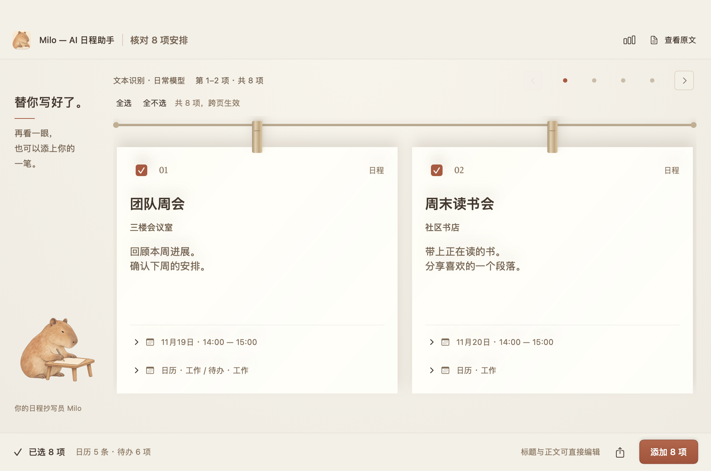

  

<h1 align="center">Milo</h1>

<strong>你的水豚日程抄写员。</strong>

把截图和消息交给 Milo，核对纸条上的安排，再记进日历与待办。

  <a href="https://github.com/Vesemir-0/Milo/releases/latest">下载 Mac 版</a> ·
  <a href="docs/USER-GUIDE.md">使用指南</a> ·
  <a href="README_EN.md">English</a>

macOS 14.6 或更新版本 · 支持 Apple Silicon 和 Intel

*画面中的安排为示例内容。*

## 交给 Milo，慢慢核对

会议通知、聊天消息、活动海报里的时间和事项，不必再逐条抄写。Milo 待在 Mac 菜单栏，把你提交的内容整理成一张张纸条，让你看清、改好，再保存。

1. **截图或输入。** 圈选屏幕上的通知，或在菜单栏小窗里粘贴、输入文字。
2. **核对并修改。** 标题、正文、时间、地点和保存目标都可以调整。
3. **添加安排。** 选好条目，保存到系统日历、提醒事项，或同时保存到两处。

## 这次，Milo 带来了什么

| 日常会用到的事 | Milo 的做法 |
| --- | --- |
| 看清每一项安排 | 暖色纸条、独立的时间与地点、可以换行的标题和正文；安排多时分组翻阅。 |
| 添加前再改一笔 | 直接编辑识别结果，跨页全选或全不选，为每项选择保存位置。 |
| 连续交来几份内容 | 整理期间仍可继续截图、输入；各份内容独立处理，完成后分别核对。 |
| 换个模型来整理 | 保存多组识别服务和模型，随时切换，也可以先检查连接。 |
| 找回上次的纸条 | 本机历史保留识别结果，重新打开继续核对；可查看耗时与服务提供的用量。 |
| 少一些打断 | 截图按 Esc 即可取消；遇到问题时给出简短原因和可尝试的调整。 |

## 下载与安装

当前版本：**Milo 2.0.0**。

| 下载 | 安装方式 |
| --- | --- |
| [DMG 安装包](https://github.com/Vesemir-0/Milo/releases/download/v2.0.0/Milo-v2.0.0-universal.dmg) | 打开后，将 Milo 拖入 Applications。 |
| [ZIP 压缩包](https://github.com/Vesemir-0/Milo/releases/download/v2.0.0/Milo-v2.0.0-universal.zip) | 解压后，将 Milo 移入 Applications。 |

启动后，点击屏幕顶部菜单栏中的水豚。在设置中添加自己的识别服务，选择模型，并按提示允许截图、日历和提醒事项所需的权限，即可开始使用。

从 AIScheduleAssistant 升级时，先退出旧版，再安装 Milo。原有本机设置会继续沿用。

## 关于你的内容

识别时，你主动提交的文字或截图会发送给你选择的识别服务。历史记录保存在这台 Mac，可自行设置保留时间或清理；截图原图默认不留存。Milo 不提供云端历史同步，安装包中不包含个人连接配置。

## 反馈与许可

欢迎在 [Issues](https://github.com/Vesemir-0/Milo/issues) 反馈问题或提出想法。提交截图时，请先遮住个人信息和连接凭据。

Milo 延续 AIScheduleAssistant，采用 [MIT 许可](LICENSE)。[查看 2.0 更新内容](CHANGELOG.md)。
