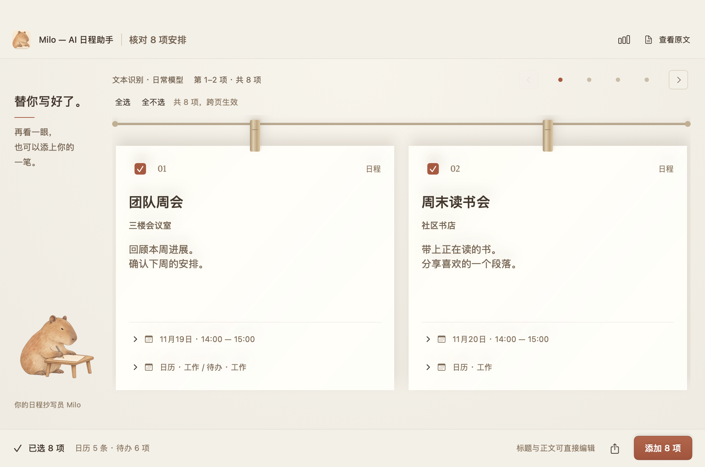

  

<h1 align="center">Milo</h1>

<strong>Your capybara schedule scribe.</strong>

Hand Milo a screenshot or message. Review the notes, then save your plans to Calendar and Reminders.

  <a href="https://github.com/Vesemir-0/Milo/releases/latest">Download for Mac</a> ·
  <a href="README.md">简体中文</a>

macOS 14.6 or later · Apple Silicon and Intel

*The plans shown are examples.*

## A note before it becomes a plan

Meeting notices, messages and event posters often contain plans worth keeping. Milo lives in your Mac's menu bar and turns the content you submit into paper notes you can review and edit before saving.

1. **Capture or type.** Select an area of your screen, or paste a message into the menu bar popover.
2. **Review and edit.** Change titles, notes, dates, locations and save destinations.
3. **Add your plans.** Save selected items to Apple Calendar, Reminders, or both.

## What's new in Milo 2.0

| What you need | How Milo helps |
| --- | --- |
| Read each plan clearly | Warm paper notes, separate dates and locations, multiline editing, and paging for longer lists. |
| Make a change before saving | Edit the extracted notes, select or deselect all items across pages, and choose destinations individually. |
| Keep submitting content | Capture or type again while earlier submissions are being processed. Each result is reviewed separately. |
| Choose a different model | Save multiple recognition services and models, switch between them, and check a connection before use. |
| Return to a previous result | Reopen local history without recognizing the same content again. Review processing time and usage when available. |
| Work with fewer interruptions | Press Esc to cancel a screenshot. When something goes wrong, see a short explanation and a practical next step. |

## Download and install

Current version: **Milo 2.0.0**.

| Download | Installation |
| --- | --- |
| [DMG installer](https://github.com/Vesemir-0/Milo/releases/download/v2.0.0/Milo-v2.0.0-universal.dmg) | Open it and drag Milo into Applications. |
| [ZIP archive](https://github.com/Vesemir-0/Milo/releases/download/v2.0.0/Milo-v2.0.0-universal.zip) | Extract it and move Milo into Applications. |

After launching, click the capybara in the menu bar. Add your recognition service in Settings, choose a model, and grant the requested screen capture, Calendar and Reminders permissions.

When upgrading from AIScheduleAssistant, quit the older app before installing Milo. Your existing local settings carry over.

## Your content

Recognition sends the text or screenshot you choose to the recognition service you select. History stays on this Mac, with retention and cleanup controls. Original screenshots are not retained by default. Milo has no cloud history sync, and downloads do not include personal connection settings.

## Feedback and license

Report issues or share ideas in [Issues](https://github.com/Vesemir-0/Milo/issues). Remove personal information and connection credentials from screenshots before posting them.

Milo continues the AIScheduleAssistant project under the [MIT license](LICENSE).
